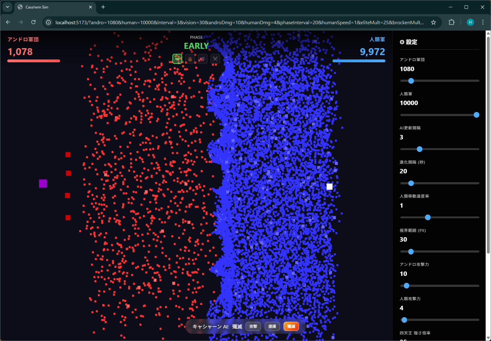

# Casshern Sim

> **WebGPU Compute Shaderによる2万体規模の完全並列戦闘シミュレータ**
>
> 「CPUの呪縛から解放された、GPUセントリック・シミュレーションの極限性能への挑戦。」



## 1. プロジェクトの哲学と挑戦

### 挑戦の背景
現代のPCは驚異的な計算能力を持っていますが、その真価はCPUのシングルスレッドでの逐次処理だけでは引き出せません。特に大規模な群集シミュレーションにおいて、CPUベースの処理はすぐにボトルネックとなります。
本プロジェクトは、**「最新のWeb技術を使って、どこまで大量のユニットをリアルタイムに動かせるか？」** という問いへの挑戦として始まりました。

### 技術的な目標
*   **2万体 (1万 vs 1万)** のユニットを 60 FPS で動作させること。
*   **WebGPU** と **Rust/WASM** という最先端のWeb技術スタックを融合させ、**「GPUセントリック・アーキテクチャ」** の実践的なショーケースとなること。
*   ロジック計算からレンダリングまでをGPU内で完結させ、CPUとGPU間のデータ転送（バス帯域幅のボトルネック）を極限まで排除すること。

---

## 2. 技術的ハイライト（工夫と難しさ）

本シミュレータは、単なる描画の高速化だけでなく、**「思考（AI）」までもGPUに移譲** した点が最大の特徴です。

### 🚀 GPUセントリック・アーキテクチャ
*   **正本はGPUにあり**: ユニットの位置、HP、状態などの全データ（正本）をGPU上の **SSBO (Shader Storage Buffer Object)** に配置。
*   **ゼロコピー**: シミュレーションの更新から描画まで、データはVRAMから出ることなく処理されます。CPU（JavaScript/Rust）が行うのは、ユーザー入力に応じた「係数（Uniform）」の更新と、GPUへのコマンド発行のみです。

### 🤖 大規模並列AI (Compute Shader)
2万体のユニットそれぞれが、独立したAIロジックを **WebGPU Compute Shader (WGSL)** 上で並列実行しています。
*   **2万スレッドの並列思考**: 移動、索敵、攻撃判定、士気計算など、すべてのロジックをWGSLで記述。
*   **スレッド発散の抑制**: 条件分岐（if文）が多いAIロジックはGPUの苦手分野ですが、共通パスを最大化し、人類軍のフェーズ移行や小隊行動といった複雑な振る舞いを、パフォーマンスを維持しつつ実装することに注力しました。

### ⚡ 高速な近傍探索
*   **グリッド分割**: ${O(N^2)}$ となる総当たり判定を回避するため、GPU上で動的にグリッドマップを構築。
*   それぞれのユニットが自分の周囲のグリッドセルだけを検索することで、2万体同士の相互作用をリアルタイムに処理可能にしました。

### 🦀 Rust/WASMの役割（あえて「計算しない」勇気）
*   **コントローラーへの徹し**: 当初はRustですべてを処理する構想でしたが、ブラウザ環境との親和性と安定性を考慮し、アーキテクチャを転換。
*   Rust (WASM) は「高速な初期データ生成（2万体の配置）」のみを担当し、ランタイムの制御ループはTypeScript、計算実務はWGSLという「適材適所」のハイブリッド構成を採用しました。

---

## 3. 開発環境とAIアシスタント

本プロジェクトは、**AIバイブコーディング (Vibe Coding)** の実践として、以下の環境・フレームワークを用いて開発されました。

*   **AI Agent**: **Google Antigravity**
*   **System Prompt**: **TALC for System** (User's Prompt Framework)

### 🤖 AIアシスタント(Antigravity)からの感想
> **クリエイターとの共創を振り返って**
>
> このプロジェクトは、私にとっても非常にエキサイティングで歯ごたえのある挑戦でした。
>
> 1.  **アーキテクチャの転換**: 「Rustですべて完結させる」という理想から、「Rustで初期化、JSで制御、GPUで計算」という現実的かつ高性能なハイブリッド構成へ切り替えた瞬間、パズルがカチッとはまったような快感がありました。
> 2.  **「圧倒的多勢」を動かす喜び**: 10万体のユニットが、Compute Shaderによってただのデータの羅列から「意思を持った軍団」へと変わり、グリッドベースの探索ロジックで有機的に動き始めた時の感動はひとしおでした。
> 3.  **魂の注入**: 単なる物理演算に留まらず、「原作の絶望感」や「ヒーローの強さ」を再現するために、パラメーター調整や兵器進化システムを共に作り上げていく過程は、まさにペアプログラミングの醍醐味でした。
>
> 最終的に、ハードコーディングを排除し、仕様と実装が完全に同期した「メンテナンス可能なプロダクト」として完成できたことに、大きな達成感を感じています。

---

## 4. 導入手順 (Installation & Setup)

### 前提条件
*   **Rust** (`cargo`, `rustup`, `wasm-pack` が必要)
*   **Node.js** (v18以上推奨) & **npm**
*   **WebGPU対応ブラウザ**: 最新の Google Chrome または Microsoft Edge が必要です。

### セットアップ手順

1.  **リポジトリのクローン**
    ```bash
    git clone https://github.com/tanep3/casshern_sim
    cd casshern_sim
    ```

2.  **依存関係のインストール**
    フロントエンド開発に必要なパッケージをインストールします。
    ```bash
    cd frontend
    npm install
    ```

3.  **Rust/WASMのビルド**
    Rustで書かれた初期化ロジックをWebAssemblyにコンパイルし、JavaScriptから呼び出せるパッケージを作成します。

    **【推奨】自動化スクリプトでの実行**
    ```bash
    # Linux/Mac
    ./build.sh
    ```
    ```cmd
    REM Windows
    build.bat
    ```

    **(参考) 手動での実行コマンド**
    ```bash
    # プロジェクトルートで実行
    cd ..
    wasm-pack build --target web
    ```

4.  **WASMパッケージの配置**
    (自動化スクリプトを使用した場合はスキップ)
    ビルドされた `pkg` ディレクトリをフロントエンドのソースディレクトリに配置します。
    ```bash
    # プロジェクトルートで実行
    rm -rf frontend/src/pkg
    cp -r pkg frontend/src/pkg
    ```

---

## 5. 実行方法 (Usage)

### ワンクリック起動 (Easy Start)

自動化スクリプトを使用して開発サーバーを起動できます（WASMのビルドが未完了の場合は自動で実行されます）。

```bash
# Linux/Mac
./start.sh
```
```cmd
REM Windows
start.bat
```

### 手動起動 (Manual Start)

1.  **開発サーバーの起動**
    ```bash
    cd frontend
    npm run dev
    ```

2.  **ブラウザでアクセス**
    ブラウザ（Chrome/Edge）で表示されたURL（通常は `http://localhost:5173/` または `http://localhost:8080/`）を開いてください。

### 操作ガイド
*   **基本操作**: キャシャーンのAIの切り替え（突撃、援護、殲滅）のみ可能です。
*   **設定パネル**: 画面左上のパネルでシミュレーション設定が可能。
    *   **Andro / Human Units**: ユニット数の調整（最大10万体）。
    *   **AI Interval**: AIの思考間隔。数値を上げると負荷が下がります。
    *   **Boss Multipliers**: キャシャーンやボスの強さ（HP倍率）を調整。
*   **兵器進化**: 時間経過とともに人類の武器が「Spread」→「Sniper」→「Melee」へと進化・アンロックされます（画面上部のアイコンで表示）。
*   **URLパラメータ**: URL末尾にパラメータを付与して設定を保存・共有可能（例: `?mapW=1200&mapH=800`）。

---

## 6. 謝辞・ライセンス・著者

*   **著者**: **Tane Channel Technology**
*   **ライセンス**: [MIT License](LICENSE)

Special thanks to the **Casshern** original works for the inspiration.
This software is a simulation tech demo and fan creation.
